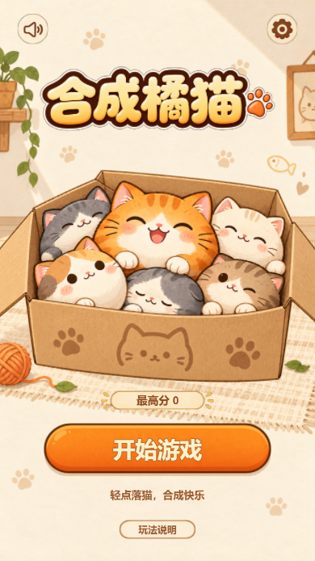
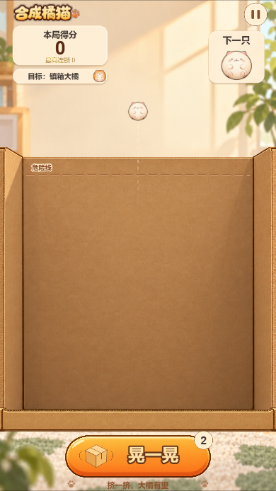
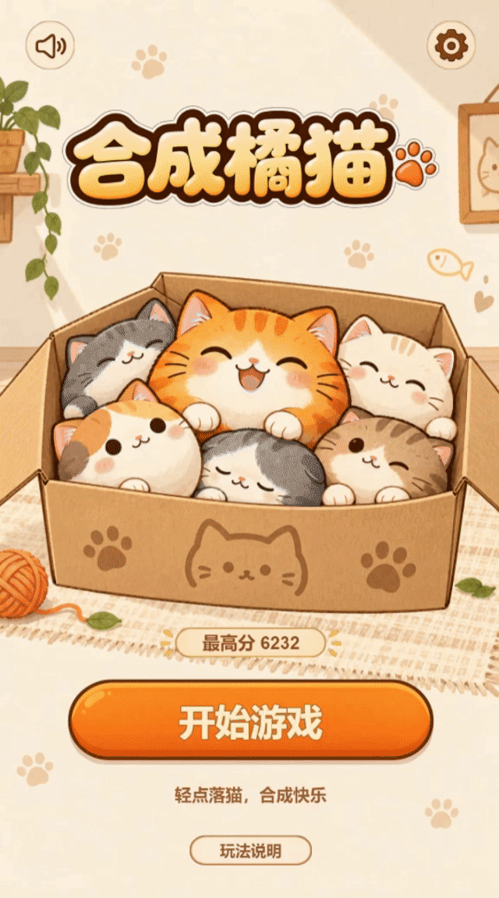

# 合成橘猫

点击落猫，让同级猫咪碰撞合成；空间紧张时晃一晃纸箱，争取合成 8 级「镇箱大橘」。

使用 **Cocos Creator 3.8.8 + TypeScript + Box2D 2D** 开发的手机竖屏合成小游戏。当前包含完整玩法、1–8 级正式美术、首页与结算页、背景音乐和音效；V1.1 已加入 1 级猫的分层动画。

> 工程目录和部分历史文档仍保留原名「猫箱挤挤」。Web Mobile 版本已构建和验证，微信小游戏构建及手机真机性能仍待验收。仓库提供工程源码，不包含编译后的在线试玩站点。

## 游戏预览

以下为当前 Web 构建在手机比例视口中的截图，不是真机截图。

<table>
  <tr><th>首页</th><th>游戏页</th></tr>
  <tr>
    <td></td>
    <td></td>
  </tr>
</table>

### 动态预览

玩法录屏 GIF 待补充，建议展示「投放 → 滚动堆叠 → 合成 → 连合提示 → 晃箱」。

<!-- 收到真实录屏后启用，暂不展示缺失图片：

-->

1 级猫的下落、团身、眨眼与伸懒腰动图也可单独补充。目录、文件名和建议规格见 [README 素材清单](docs/readme/ASSETS.md)。

## 已实现功能

- **物理合成**：点击选择投放横坐标，猫咪从固定高度自然下落；同级接触合成，共 8 个等级。
- **解困与结算**：每局两次晃箱机会，含冷却；危险线持续越线失败，首次合成 8 级通关。
- **合成反馈**：源猫短暂收拢、新猫放大回弹，连合文字显示在产物上方并淡出。
- **1 级猫动画**：等待收爪、下落探爪、首次接触团身、稳定呼吸、随机微睁眼；长时间未受有效碰撞后伸懒腰。
- **界面与音频**：首页、当前/下一只预览、分数、暂停、成功/失败结算、重新开始、BGM 与音效开关。
- **后台处理**：切后台暂停，返回后由玩家点击继续；最高分和音频偏好本地记录。

当前随机投放包含 1–4 级，概率为 55% / 30% / 10% / 5%，前四只固定为 1、1、2、1。规则参数集中配置，动画只改变视觉节点，不改变刚体和碰撞尺寸。

## 运行环境与开发环境

| 项目 | 当前配置 |
| --- | --- |
| 编辑器 | **Cocos Creator 3.8.8**，通过 Cocos Dashboard 导入工程 |
| 开发语言 | TypeScript，使用当前引擎提供的编译工具 |
| 物理系统 | Box2D 2D，固定物理步长 1/60 秒 |
| 设计分辨率 | 720 × 1280，手机竖屏，等比适配 |
| 已验证构建 | Web Mobile，桌面浏览器与手机比例视口 |
| 浏览器 | 需支持 WebGL；自动化验证使用 Chromium |
| 本次开发系统 | Windows，其他操作系统未在本项目中验证 |
| 辅助工具 | Node.js / npm；本次本地使用 Node.js v24.15.0 |
| 可选自动化工具 | Playwright + Chromium，仅浏览器回归检查需要 |

日常运行通过 Creator 即可。`npm run serve` 使用 Node.js 标准库提供静态服务，无需安装第三方游戏运行依赖。

## 快速开始

### 1. 获取源码

```bash
git clone https://github.com/870491465/hechengjumao.git
cd hechengjumao
```

### 2. 用 Creator 预览

1. 打开 Cocos Dashboard，使用 **Creator 3.8.8** 导入仓库根目录。
2. 等待首次资源导入与脚本编译完成。
3. 打开 `assets/scenes/CatBox.scene`。
4. 点击编辑器顶部的**浏览器预览**按钮，使用竖屏视口试玩。

界面由运行时脚本创建；编辑状态下没有显示完整游戏界面是正常现象，无需手动拼装节点或绑定全部美术。

### 3. 构建并在本机运行

1. 打开 Creator 的「项目 → 构建发布」。
2. 平台选择 **Web Mobile**，开始场景选择 **CatBox**。
3. 确保最终输出目录为 `build/web-mobile`，完成构建。
4. 在仓库根目录执行：

```bash
npm run serve
```

打开 **http://localhost:8080/**。不要直接双击构建目录的 HTML。

`build/` 没有提交到 Git，新克隆的项目必须先构建。`npm run serve` 只启动服务，不会自动编译游戏。通过静态服务试玩时，修改源码后需要重新构建并刷新页面。

### 4. 手机浏览器试玩

电脑与手机连接同一 Wi-Fi，保持服务运行，用手机访问 `http://电脑局域网IP:8080/`。例如电脑地址为 `192.168.1.10`，则访问 `http://192.168.1.10:8080/`；如无法连接，检查网络互通及系统防火墙是否允许该端口。

### 微信小游戏说明

当前仓库不是可直接导入微信开发者工具的构建目录。后续需由 Creator 选择「微信小游戏」平台，配置小游戏 AppID，再导入对应输出目录。本仓库尚未完成该平台的构建与真机验收。

## 开发调试与验证

### 单猫动画对照

在 Debug Web 构建中，可用以下地址重复观察等待、下落、接触、团身和待机：

| 地址参数 | 用途 |
| --- | --- |
| `http://localhost:8080/?catTest=1&catAnim=1` | 新版 1 级猫动画；投放后静置可观察微睁眼、伸懒腰 |
| `http://localhost:8080/?catTest=1&catAnim=0` | V1.0 视觉对照 |
| 追加 `&colliders=1` | 显示真实碰撞轮廓 |

这些入口仅在 DEBUG 环境生效，正式发布界面不显示调试按钮。更多操作见 [V1.1 单猫动画验证](docs/V1.1单猫动画验证.md)。

### 常用检查

首次用 Creator 打开工程、生成 `temp/tsconfig.cocos.json` 后，可执行：

```bash
npm run check
```

该命令执行业务 TypeScript 与规则检查。浏览器自动化另需配置 Playwright、Chromium 和运行中的 Debug 页面。

| 命令 | 检查内容 |
| --- | --- |
| `npm run test:runtime` | 投放、碰撞、合成、晃箱、胜负与输入 |
| `npm run test:lifecycle` | 清理、场景重载及加载中断 |
| `npm run test:merge-feedback` | 合成收拢、回弹与就地连合文字 |
| `npm run test:level-one` | 单猫动画与新旧视觉的物理回放对照 |
| `npm run test:level-one-stretch` | 伸懒腰触发、互斥、打断与清理 |

`test:runtime` 测试 Web 构建时，设置 `CATBOX_URL=http://localhost:8080/`；所需的 `PLAYWRIGHT_MODULE`、`CHROMIUM_PATH` 等配置见 [运行与验收文档](docs/灰盒原型-运行与验收.md)。部分单猫验证脚本固定使用本机 8080 端口。

已执行过引擎构建、类型检查及浏览器物理/动画回归；这些结果不替代手机真机帧率、内存、触控手感和微信小游戏生命周期验证。

## 工程结构与调参

```text
assets/
  scenes/CatBox.scene          主场景
  scripts/                    玩法、输入、实体、视觉、界面与音频
  resources/art/              场景、UI 与 1–8 级猫美术
  resources/cat-level-01-v11/  1 级猫的身体、眼睛、嘴和四爪
  resources/audio/            BGM 与音效
docs/                         文档、资源说明、验证记录及截图
settings/                     Creator 项目配置
tests/                        规则测试
tools/                        本地服务与验证脚本
```

| 文件 | 职责 |
| --- | --- |
| `GameConfig.ts` | 等级半径、概率、分数、物理、冷却与危险计时 |
| `LevelOneConfig.ts` | 1 级猫部件对齐、动作时长、幅度及稳定阈值 |
| `GameController.ts` | 物理步进、流程、暂停、胜负及重开 |
| `CatEntity.ts` / `MergeSystem.ts` | 实体与稳定合成配对 |
| `LevelOneVisual.ts` / `MergeEffects.ts` | 单猫分层动作与合成视觉反馈 |
| `GameView.ts` / `HomeView.ts` / `WinView.ts` | 游戏页、首页与成功/失败结算 |
| `ArtAssets.ts` / `GameAudio.ts` | 美术映射与音频播放 |

以上脚本位于 `assets/scripts/`。引擎缓存、构建目录、临时文件和 `node_modules/` 已排除在版本管理之外。

## 版本与项目文档

- **V1.0 回退标签**：`v1.0-accepted-20261024`。
- **V1.1 当前增量**：1 级猫分层动作、安静待机伸懒腰，以及「合成橘猫」标题替换。

| 主题 | 文档 |
| --- | --- |
| 玩法规则 | [玩法 PRD](docs/猫箱挤挤-玩法PRD-V1.0.md) |
| 运行与验收 | [运行步骤与职责](docs/灰盒原型-运行与验收.md)、[验证记录](docs/灰盒原型-验证记录.md) |
| 美术 | [首批正式美术](docs/正式美术接入-V1.md)、[4–8 级猫校准](docs/4-8级猫美术接入.md) |
| 页面 | [游戏页 UI](docs/游戏页UI优化.md)、[首页](docs/首页接入与验收.md)、[成功页](docs/成功结算页接入与验收.md)、[失败页](docs/失败结算页接入与验收.md) |
| 动效与手感 | [合成反馈及空间压力](docs/合成反馈与空间压力.md)、[晃箱调整](docs/晃箱手感调整.md)、[接触缝隙修复](docs/贴图接触缝隙修复.md) |
| 动画 | [V1.1 单猫动画、开关与验证](docs/V1.1单猫动画验证.md) |
| 投放与音频 | [4 级随机投放](docs/4级随机投放调整.md)、[音效 V0.3](docs/音效V0.3接入与验收.md)、[投放接触音 V0.4](docs/投放接触V0.4替换记录.md) |

历史文档记录了不同阶段的参数，当前实现以代码集中配置和后续调整记录为准。

## 联系作者

[GitHub：870491465](https://github.com/870491465)

**个人微信：二维码待补充。**

<!-- 收到作者提供的二维码后启用：

-->

个人微信号和二维码由作者提供后填写，此处暂不代填。需要补充的图片请按 [素材清单](docs/readme/ASSETS.md) 放置。
